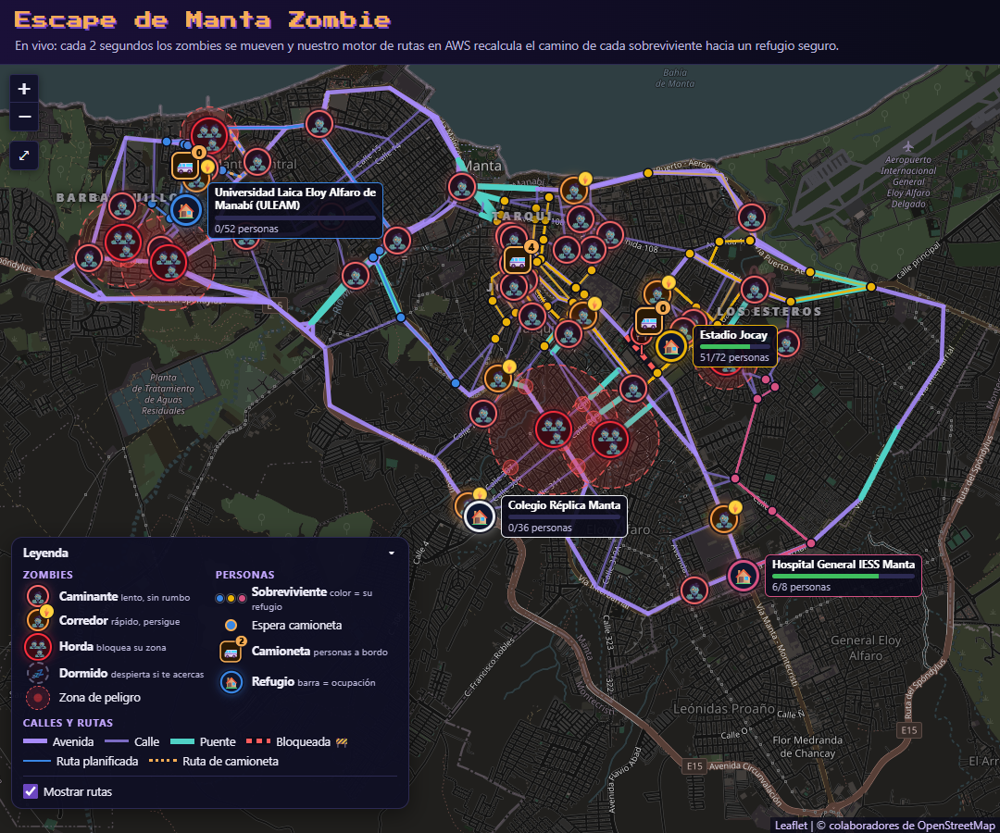
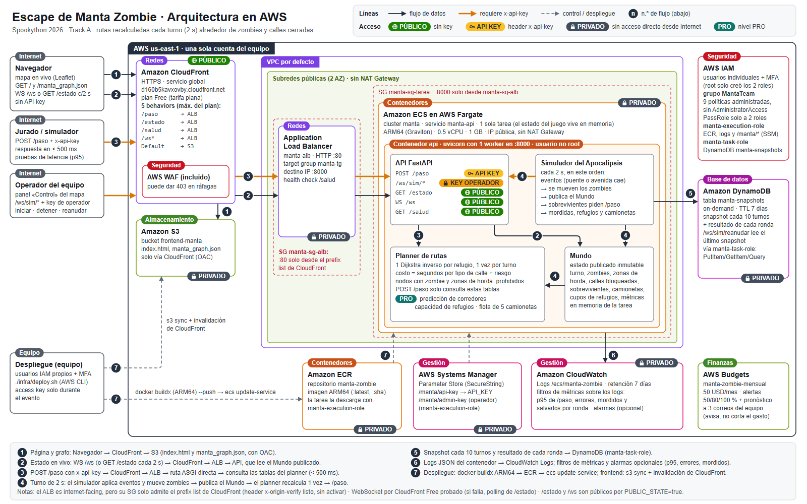
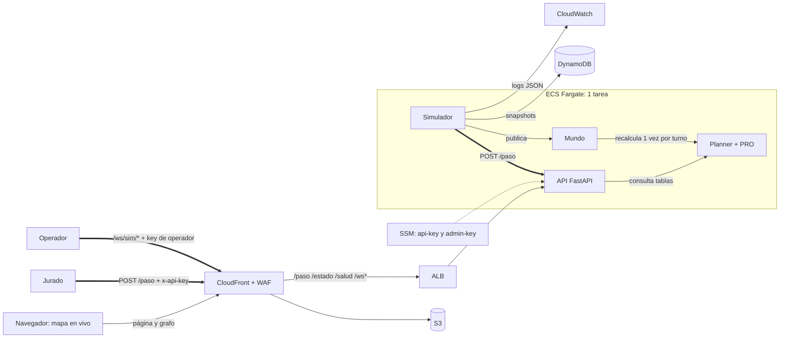

# Escape de Manta Zombie · Track A (Spookython 2026)

[](https://github.com/TheDarw1n/menincloud_spookython-2026/actions/workflows/ci.yml)

Motor de rutas en AWS que recalcula en tiempo real alrededor de zombies y calles cerradas, y responde rápido aunque 200 sobrevivientes pidan ruta a la vez. Es la base de una app de delivery, de un despacho de ambulancias o de una ruta de evacuación ante tsunamis en Manabí: basta cambiar «zombie» por «calle cerrada» o «zona inundada».

| | |
|---|---|
| **Mapa en vivo** | https://d160b5kavxovby.cloudfront.net ([captura](docs/mapa_en_vivo.png)) |
| **Endpoint del track** | `POST https://d160b5kavxovby.cloudfront.net/paso` con header `x-api-key` |
| **Pitch** | [`docs/pitch.pdf`](docs/pitch.pdf) (8 diapositivas, 5 minutos) · [`docs/pitch.pptx`](docs/pitch.pptx) con notas del orador |
| **Arquitectura** | [`docs/arquitectura.png`](docs/arquitectura.png) · fuente editable [`docs/arquitectura.drawio`](docs/arquitectura.drawio) · [SVG](docs/arquitectura.svg) |
| **Costos** | [`docs/costos.md`](docs/costos.md): ≈ 41.86 USD/mes 24/7 · ≈ 6.90 USD el evento |
| **AWS Budget con alerta** | [captura](#aws-budget) |
| **Grafo de Manta** | [`docs/grafo_manta.png`](docs/grafo_manta.png): 307 intersecciones reales de OpenStreetMap |



## Resultados

**Prueba de fuego en un contenedor ARM64 con los límites de la tarea de Fargate** (Graviton en AWS; aquí el runner ARM64 de GitHub Actions con `--cpus 0.5 --memory 1g`, el simulador llamando `POST /paso` por HTTP; 3 rondas de 30 turnos con sus eventos de ciudad, en cada push a `main` y en cada PR):

| | R1 Anochecer | R2 Medianoche | R3 Apocalipsis |
|---|---|---|---|
| Supervivencia | 1.000 | 0.992–0.993 | 0.947–0.954 |
| Eficiencia (contra el mínimo de calles) | 0.88–0.97 | 0.87–0.89 | 0.80–0.83 |
| p95 de `POST /paso` | 1.8–1.9 ms | 6.1 ms | 14.2–14.6 ms |
| Errores o respuestas > 500 ms | 0 % | 0 % | 0 % |
| **Puntaje de la rúbrica** | | | **9.54–9.61 / 10** |

Carga externa con [`latency.py`](src/simulator/latency.py) contra ese mismo contenedor, un turno cada 2 s: 200 concurrentes → **p95 26–28 ms, 0 % de errores** (80 → p95 12–15 ms). El umbral de 10 puntos es 150 ms.

**Todo a la vez** (lo que pasaría frente al jurado): R3 del simulador interno + 200 consultas externas por turno con `latency.py` + 30 visores del mapa por WebSocket, en el mismo contenedor ARM64 de 0.5 vCPU → R3 interna **p95 15.8 ms**, externa **p95 13.8 ms** (p99 30 ms), **0 % de errores** y 0 visores caídos. Las cifras de cada corrida quedan como anotaciones públicas del job `carga` en [Actions](https://github.com/TheDarw1n/menincloud_spookython-2026/actions/workflows/ci.yml).

**Rondas completas de 150 turnos** (5 minutos), simulador sin HTTP, grafo de Manta, promedio por ronda de 6 semillas ([`tools/ab_planner.py`](tools/ab_planner.py)):

| | R1 | R2 | R3 |
|---|---|---|---|
| Supervivencia | 0.9997 | 0.9953 | 0.9800 |
| Eficiencia | 0.939 | 0.820 | 0.737 |
| Mordidos | 0.2 | 5.7 | 49.5 |
| Rescatados en camioneta | 13 | 274 | 446 |
| Llegadas a un refugio lleno | 0 | 3.2 | 9.7 |

Supervivencia + eficiencia ponderadas como la rúbrica: **6.54 de 7**. Con latencia y disponibilidad en 10 (medidas arriba), la prueba de fuego estimada es **≈ 9.5 / 10**.

> Pendiente del equipo: correr la prueba en AWS con `./infra/deploy.sh prueba` desde CloudShell y pegar aquí el resultado (ver [Cómo se mide la latencia](#cómo-se-mide-la-latencia)).

## Qué hace

1. **Mapa real de Manta.** 307 intersecciones y 503 calles de OpenStreetMap (191 avenidas, 279 calles, 33 puentes sobre los ríos Manta y Burro), con distancia y tipo de cada calle. Los sobrevivientes están atrapados en **Tarqui, Los Esteros, Barbasquillo y Jocay** (cada barrio es su zona de OSM recortada a su parroquia real) y hay 4 refugios en lugares reales y altos, lejos de la costa: **ULEAM, Estadio Jocay, Hospital General IESS Manta y Colegio Réplica Manta**.
2. **Simulador del Apocalipsis.** Cada 2 s: primero se mueven los zombies, se publica el mundo (`GET /estado` y WebSocket `/ws`), cada sobreviviente pregunta `POST /paso` y al final se cuentan mordidas y llegadas.
3. **Motor de rutas.** Recalcula **una vez por turno** (no por petición) un Dijkstra inverso por refugio con los zombies del turno; `POST /paso` solo consulta esas tablas: O(grado del nodo), sin bloquear.
4. **Mapa en vivo** ([`frontend/index.html`](frontend/index.html)): zombies con ícono por tipo, sobrevivientes con su ruta planificada, camionetas, ocupación de refugios, calles cerradas, zonas de horda, eventos y el puntaje en vivo. Se actualiza por WebSocket y, si no conecta, por polling cada 2 s.

## Cómo decide cada paso

Para el sobreviviente en `u`, `/paso` elige el vecino `v` que minimiza `calle(u,v) + penalización(v) + resto(v → refugio)`:

- **Costo de una calle** = distancia ÷ velocidad del tipo (avenida 50 km/h, calle 30, callejón 15, puente 40) **+ 30 s por intersección**. En el juego cada calle es un turno, así que sin ese término el planner prefería tres calles cortas a una larga: medido sin zombies, la eficiencia sube de 0.86 a 0.98.
- **Prohibido** (con los zombies que ya se movieron este turno): nodos con zombie visible, el nodo de cada horda **y todos sus vecinos**, calles cerradas, y **cruzarse** con un zombie por la misma calle en sentido opuesto (se publican los 2 pasos de cada corredor). Quedarse quieto también es una jugada válida; si su nodo es letal y no hay camino, huye a cualquier vecino seguro.
- **Ninguna mordida evitable:** un test juega R1, R2 y R3 completas (150 turnos, con todos los eventos de ciudad) en el grafo real y exige que cada mordido no tuviera ninguna jugada segura con las reglas reales ([`tests/test_puntaje.py`](tests/test_puntaje.py)).

### Nivel PRO

Medido con [`tools/ab_planner.py`](tools/ab_planner.py) (3 rondas × 150 turnos × 6 semillas, supervivencia + eficiencia de 7). Cada fila le quita una pieza a producción:

| Variante | Supervivencia + eficiencia | Qué cambia |
|---|---|---|
| **Producción (todo activo)** | **6.539** | |
| Sin predicción | 6.502 | R2 pierde 2.3 puntos de eficiencia |
| Sin flota | 6.478 | R3: eficiencia 0.737 → 0.699 |
| Sin los 3 PRO | 6.473 | además el mundo queda sin cupos |
| Sin costo por intersección | 6.339 | R1: eficiencia 0.939 → 0.797 |
| Sin PRO ni costo por intersección (penalización ingenua por vecino) | 6.282 | R3: supervivencia 0.969, eficiencia 0.627 |
| Sin capacidad (refugios sin límite) | 6.531 | el mundo es más fácil: no hay cupos |
| Sin reparto por cupo (los cupos siguen; todos van al refugio más barato) | 6.554 | R3: 26 mordidas por ronda en vez de 50, pero 67 llegadas a un refugio lleno en vez de 10 |

- **Predicción de corredores** ([`src/routing/riesgo.py`](src/routing/riesgo.py)). El planner replica la persecución de cada corredor (2 calles por turno hacia el sobreviviente más cercano a ≤ 3), sabe que un caminante que acaba de moverse no se mueve el turno siguiente y que una horda puede correr su zona. Con eso penaliza solo las **trampas**: nodos donde un zombie puede caer el próximo turno y desde los que no quedaría salida. Alejarse de cualquier zombie (lo que hacíamos al principio) alargaba las rutas y terminaba mordiendo más.
- **Capacidad de refugios** ([`src/routing/capacidad.py`](src/routing/capacidad.py)). Cada refugio tiene cupo y evacúa E personas por turno hacia la zona segura. Cada turno el planner reparte en orden de llegada al refugio más barato que tenga cupo proyectado para la hora de llegada. Frente a mandar a todos al más barato (y que esperen en la puerta), las llegadas a un refugio lleno bajan 84 % (R2+R3: 80 → 13 por ronda). **Tiene un costo:** desviar a alguien a un refugio más lejano lo expone más, y en R3 las mordidas suben de 28 a 45 por ronda (12 semillas, peor en 11 de ellas). Lo dejamos activo porque en el juego la puerta de un refugio fortificado es segura, pero en una evacuación real un refugio lleno no lo es. Cobrar la espera en la puerta o limitar el desvío a 60–240 s no mejoró el total (`asig=0` en `ab_planner.py` mide esta comparación).
- **Flota de rescate** ([`src/routing/flota.py`](src/routing/flota.py)). 5 camionetas, 2 calles por turno, 4 plazas. Cada turno el servidor asigna a cada una el sobreviviente de mayor valor `(turnos ahorrados + 2 × riesgo) / (1 + turnos en llegar)` si le ahorra ≥ 2 turnos, con pasajeros solo se desvía 1 turno y si no, entrega en el refugio con cupo más cercano. Esperar quieto 3 turnos a la camioneta o desviarse 2 con gente a bordo empeoraba la eficiencia, por eso esos límites.

### Reglas del simulador y supuestos declarados

Turno de 2 s, primero zombies y luego sobrevivientes. Caminante: 1 calle cada 2 turnos al azar. Corredor: 2 calles por turno, persigue si hay alguien a ≤ 3 nodos. Horda: casi inmóvil (10 % de avanzar), su nodo y **todos sus vecinos** muerden. Dormido: invisible (no se publica) hasta que alguien está a ≤ 2 nodos; despierta como caminante. Mordida: compartir nodo al final del turno o cruzarse por la misma calle. Eventos: R2 colapsa un puente (turno 40), R3 cierra dos avenidas (turnos 30 y 75); en rondas más cortas esos turnos se escalan. Se elige la calle más usada por las rutas planificadas sin aislar ninguna zona.

Supuestos propios (no están en el enunciado; se pueden cambiar):

| Supuesto | Por qué | Variable | Impacto medido |
|---|---|---|---|
| **Refugios fortificados**: ningún zombie entra a un refugio y la zona de una horda no los cubre | Es lo que hace un refugio; sin esto un zombie puede bloquear un refugio toda la ronda | `REFUGIOS_FORTIFICADOS=0` para la lectura literal | supervivencia + eficiencia 6.539 → 6.391 de 7 |
| **Población continua**: siempre N sobrevivientes en juego (al salvarse o morir aparece otro) | «200 a la vez» y 5 minutos de carga sostenida sobre `/paso` | `SIM_POBLACION=fija` (sin reponer; los eventos ocurren antes) | — |
| **Supervivencia** = salvados ÷ (salvados + mordidos) | Con población continua siempre quedan N en juego | cada resultado trae también `supervivencia_cohorte` (cuenta en juego como no salvados) | — |
| **Eficiencia** = mínimo de calles posible hasta el refugio más cercano (sin zombies) ÷ turnos reales, tope 1 | La lectura más estricta de «turnos vs. ruta más corta sin zombies» | — | — |
| Cupos de refugios y cantidad de zombies por ronda | El enunciado no los fija | `src/simulator/engine.py` (`RONDAS`, `EVAC_FACTOR`, `CUELLO`) | — |

## Arquitectura en AWS



`Navegador / jurado → CloudFront (HTTPS, plan Free con WAF) → S3 (mapa y grafo) | ALB → ECS Fargate (1 tarea ARM64 0.5 vCPU / 1 GB: API + simulador + planner con el estado en memoria) → DynamoDB (snapshots) · SSM (keys) · CloudWatch (logs) · ECR (imagen)`. Todo en **us-east-1**.

- **Fargate y no Lambda:** sin arranques en frío y con el estado del mundo en la memoria de un solo proceso (la rúbrica penaliza guardar estado en la memoria de una Lambda, donde cada instancia tiene su copia).
- **Rutas calculadas por turno, no por petición:** el planner se recalcula una vez, al publicar los zombies del turno, y deja snapshots inmutables; `POST /paso` es una ruta ASGI directa (sin pydantic) que solo consulta tablas.
- **El simulador consulta `/paso` por HTTP** con un cliente HTTP/1.1 mínimo de conexiones persistentes ([`src/simulator/cliente.py`](src/simulator/cliente.py)). Con httpx, en el mismo event loop, el 79 % de las consultas de la ronda 3 pasaba los 500 ms; con este cliente, 0 %.
- **El estado se serializa una vez por publicación** (dos por turno: zombies y fin de turno) y lo comparten `/estado` y todos los WebSocket (máximo 100 visores; el resto cae a polling). El WebSocket va **sin compresión por mensaje**: comprimir ~40 KB costaba ~1 ms de CPU por visor y por mensaje.
- **DynamoDB en segundo plano** con timeouts de 1 s: un DynamoDB lento nunca congela el turno, y boto3 se prepara al arrancar (importarlo en el primer snapshot costaba ~1 s de CPU a mitad de ronda). `POST /ws/sim/reanudar` retoma el último snapshot tras un reinicio.
- **Sin Redis, NAT Gateway, API Gateway ni Secrets Manager:** costo fijo innecesario para una sola tarea.
- **Límites del plan Free de CloudFront:** 5 cache behaviors (Default→S3, `/paso`, `/estado`, `/salud`, `/ws*`), por eso el grafo es un archivo estático de S3 y el control del simulador vive bajo `/ws/sim/*`. El WAF incluido puede devolver 403 ante ráfagas: medirlo con `./infra/deploy.sh prueba`.



## Seguridad e IAM

- Usuarios IAM **individuales** (Kenneth, Jonathan, Jostin) con consola, cambio de contraseña obligatorio y **MFA**. Nadie usa root (solo se usó para crear los 2 roles de la tarea).
- Grupo `MantaTeam` con 9 políticas administradas (ECS, ECR, DynamoDB, S3, CloudFront, CloudWatch, SSM, ELB y VPC); **sin** AdministratorAccess, IAM, facturación ni Organizations. Política en línea `pasar-roles-ecs`: `iam:PassRole` solo sobre los 2 roles de ECS.
- `manta-execution-role`: ejecución de ECS + lectura de `/manta/api-key` y `/manta/admin-key`. `manta-task-role`: `dynamodb:PutItem/GetItem/Query` solo sobre `manta-snapshots`.
- **Dos keys en SSM Parameter Store (SecureString)**, inyectadas al arrancar; nunca en el código ni en el repo:
  - `API_KEY` (`/manta/api-key`): la que se entrega al jurado. Solo sirve para `POST /paso`.
  - `ADMIN_API_KEY` (`/manta/admin-key`): la del operador. Solo sirve para `/ws/sim/*` (iniciar, detener, reanudar, resultados). Así quien tiene la key de `/paso` no puede detener una ronda.
- `/estado` y `/ws` son de **lectura pública** (`PUBLIC_STATE=true`): el navegador no puede guardar una key y solo publican el estado visible del juego (los dormidos no se publican). Con `PUBLIC_STATE=false` exigen la key.
- `POST /paso` valida tipos y tamaño (422 / 413). `/docs` y `/openapi.json` están apagados (`EXPONER_DOCS=1` solo en desarrollo).
- Contenedor con usuario no root; security groups encadenados CloudFront → `manta-sg-alb` (:80) → `manta-sg-tarea` (:8000).

## Contrato técnico

| Método y ruta | Acceso | Cuerpo / respuesta |
|---|---|---|
| `POST /paso` | `x-api-key` | `{"sobrevivienteId": "S-0089", "nodoActual": "N-0117", "turno": 142}` → `{"siguienteNodo": "N-0118"}` |
| `GET /estado` · `WS /ws` | público | `{turno, ronda, corriendo, turnosRestantes, zombies[{id,tipo,nodo,previo,visible,pasos}], aristasBloqueadas[], zonasHorda[], sobrevivientes[{id,nodo,refugio,estado,ruta}], refugios[{id,nodo,nombre,capacidad,ocupacion,evacuaPorTurno}], camionetas[], eventos[], metricas, resultados[], puntaje}` |
| `GET /salud` | público | `{"ok": true}` (health check del ALB) |
| `POST /ws/sim/iniciar?ronda=1\|2\|3\|ciclo` · `POST /ws/sim/detener` · `POST /ws/sim/reanudar` · `GET /ws/sim/resultados` | key de operador | control del simulador y resultados por ronda con el puntaje |

`siguienteNodo` siempre es un vecino por una calle abierta o el mismo nodo; un nodo desconocido responde el mismo nodo.

Todas las claves de `/estado` existen desde el arranque (`puntaje` es `null` hasta que termina la primera ronda). `capacidad`, `ocupacion` y `evacuaPorTurno` de cada refugio aparecen al iniciar una ronda con `PRO_CAPACIDAD=1`. `/ws` manda el estado completo cada vez que cambia y `{"ping": true}` tras ~20 s sin cambios; si el cliente envía datos, se cierra con 1008.

## Cómo probar en local

```bash
python -m venv .venv && source .venv/bin/activate      # Windows: .venv\Scripts\activate
pip install -r requirements-dev.txt
pytest                                                 # 58 tests
python tools/validar_grafo.py data/manta_graph.json

# Ronda completa sin HTTP (rápido): 1, 2, 3 o ciclo
TURNO_S=0 SEED=1 python -m src.simulator.run_simulator ciclo

# Servidor + mapa en http://localhost:8000 (SERVIR_FRONTEND=1 sirve el mapa: también es el plan B sin AWS)
API_KEY=dev SERVIR_FRONTEND=1 uvicorn src.api.main:app --port 8000      # UN solo worker
curl -X POST "localhost:8000/ws/sim/iniciar?ronda=ciclo" -H "x-api-key: dev"
curl -X POST localhost:8000/paso -H "x-api-key: dev" -H "content-type: application/json" \
  -d '{"sobrevivienteId":"S-0089","nodoActual":"N-0001","turno":1}'
curl -H "x-api-key: dev" localhost:8000/ws/sim/resultados | python tools/resumen_resultados.py
```

Si el servidor no corre en el puerto 8000, exporta `SIM_URL=http://127.0.0.1:PUERTO` (el simulador llama a `/paso` ahí).

| Variable | Default | Para qué |
|---|---|---|
| `API_KEY` / `ADMIN_API_KEY` | — | key de `/paso` / key de operador (sin `ADMIN_API_KEY`, en local, sirve la `API_KEY`) |
| `SIM_MODO` | `http` | `http`: el simulador llama a `POST /paso` por HTTP; `directo`: llama al planner sin HTTP |
| `SIM_URL` | `http://127.0.0.1:8000` | a dónde llama el simulador en modo http |
| `SIM_AUTOSTART` | `none` | `1`, `2`, `3` o `ciclo` arranca al iniciar (espera a que el puerto acepte conexiones) |
| `SIM_POBLACION` | `continua` | `fija`: sin reponer sobrevivientes |
| `TURNO_S` / `TURNOS_RONDA` | `2.0` / `150` | duración del turno y de la ronda |
| `PRO_PREDICCION` / `PRO_CAPACIDAD` / `PRO_FLOTA` | `1` | apagar cada extra PRO con `0` |
| `REFUGIOS_FORTIFICADOS` | `1` | `0` = lectura literal del enunciado |
| `PUBLIC_STATE` | `true` | `false` exige key en `/estado` y `/ws` |
| `MAX_WS` | `100` | visores simultáneos por WebSocket |
| `SNAPSHOTS_TABLE` | — | tabla de DynamoDB (sin ella no guarda snapshots) |
| `GRAPH_PATH` | `data/manta_graph.json` | grafo |
| `SERVIR_FRONTEND` / `EXPONER_DOCS` | `0` | solo para desarrollo local |
| `ORIGIN_SECRET` | — | opcional: exige el header `x-origin-verify` que agrega CloudFront |

## Cómo desplegar

La infraestructura se creó **a mano en la consola** (sin IaC); la configuración de la tarea está en [`infra/task-definition.json`](infra/task-definition.json).

1. **Key de operador** (una vez): en SSM Parameter Store crear `/manta/admin-key` (SecureString, distinta de `/manta/api-key`) y agregar su ARN a la política de `manta-execution-role` (`ssm:GetParameters`). Con la clave administrada `aws/ssm` no hace falta `kms:Decrypt`.
2. **Task definition:** `infra/task-definition.json` se **reconstruyó** a partir de la configuración descrita (no se exportó de la consola). Antes de registrarla, compararla con la revisión actual (ECS > Task definitions > manta-api > JSON). Después, `./infra/deploy.sh taskdef` registra una revisión nueva: reemplaza `<ACCOUNT_ID>` y trae `ADMIN_API_KEY` y la configuración de los PRO.
3. **Backend y frontend:** `./infra/deploy.sh` hace dos cosas:
   - backend: imagen ARM64 a ECR, `ecs update-service` con la **última revisión** de `manta-api` y espera a que el servicio quede estable;
   - frontend: `frontend/` y `data/manta_graph.json` a S3 e invalidación de CloudFront.

   También se puede correr por partes: `./infra/deploy.sh backend | frontend`.
4. **Verificar:** desde CloudShell en us-east-1, con el repo clonado: `API_KEY=... ./infra/deploy.sh prueba` (salud, grafo, un `/paso` y `latency.py`).

- `deploy.sh` usa `minimumHealthyPercent=0 / maximumPercent=100`: **nunca hay 2 tareas con estados distintos**, a costa de ~1 min de corte por despliegue.
- Construir ARM64 desde un PC x86 usa emulación (lento). Alternativa: `PLATFORM=linux/amd64 ./infra/deploy.sh backend` y `runtimePlatform` a `X86_64`.
- **Credenciales de CLI:** cada persona que despliega crea **una** access key de **su** usuario IAM (nunca de root, nunca en el repo) y la borra al terminar el evento.
- **Cierre del evento:** ver [`docs/costos.md` § 9](docs/costos.md#9-cierre-del-evento). El ALB, Fargate y las IPv4 cobran por hora (1.374 USD/día).

## Cómo se mide la latencia

- **El simulador mide cada `POST /paso`** desde que envía la petición hasta que llega la respuesta (incluye los timeouts de 500 ms) y reporta p50/p95/p99, errores y el puntaje de la rúbrica en `/ws/sim/resultados` y en el mapa.
- **Carga externa:** `python -m src.simulator.latency URL API_KEY --niveles 20,80,200 --turnos 10 --intervalo 2` abre N conexiones (N sobrevivientes a la vez), manda N consultas por turno con nodos distintos e imprime p50/p95/p99, % de errores y el puntaje. Solo usa la librería estándar.
- **Para separar red de servidor:** correrlo desde **CloudShell en us-east-1** (`./infra/deploy.sh prueba`). Desde Ecuador se suman ~100 ms de red.
- **En cada push a `main` y en cada PR**, la CI levanta el contenedor ARM64 con `--cpus 0.5 --memory 1g`, juega las 3 rondas por HTTP y corre `latency.py`; los resultados quedan como anotaciones en la pestaña [Actions](https://github.com/TheDarw1n/menincloud_spookython-2026/actions).
- **CloudWatch:** el contenedor escribe una línea JSON por cada 10 turnos (`"evento": "turno"`), por evento de ciudad y por ronda (`"evento": "resultado_ronda"` y `"puntaje"`). Para graficarlas, crear filtros de métricas sobre `/ecs/manta-zombie`, por ejemplo `{ $.evento = "resultado_ronda" }` con valor `$.latencia_ms.p95`.

## Costos

Resumen de [`docs/costos.md`](docs/costos.md) (precios verificados el 2026-10-27 contra la AWS Price List API):

| | USD |
|---|---|
| 24/7 durante un mes (Fargate 14.42 + ALB 16.47 + 3 IPv4 10.95 + resto) | ≈ 41.86 |
| Evento del 26 al 30 de octubre (120 h) | ≈ 6.90 |
| Gasto real según Cost Explorer | pendiente ([pasos](docs/costos.md#6-gasto-real-durante-el-evento)) |

## AWS Budget

`manta-zombie-mensual`: 50 USD/mes, alertas al 50, 80 y 100 % (y pronosticado) a los 3 correos del equipo, sobre el gasto **bruto** (sin créditos). **Avisa, no corta el gasto.**


> Pendiente del equipo: guardar la captura del Budget como `docs/budget.png`.

## Limitaciones conocidas

- **Un solo contenedor con el estado en memoria** (1 worker de uvicorn, nunca `--workers > 1`). Un reinicio pierde la ronda en curso (se retoma con `/ws/sim/reanudar`). Escalar a varias réplicas exige compartir las tablas del turno (ver `docs/costos.md` § 8).
- El tramo CloudFront → ALB va por **HTTP** (sin dominio propio). El ALB solo acepta el prefix list de CloudFront; `ORIGIN_SECRET` está listo (el simulador interno también manda el header) pero sin activar.
- **WebSocket por CloudFront (plan Free) sin probar en AWS:** si no conecta, el mapa cae solo a polling de `/estado` cada 2 s (el HUD dice cuál usa).
- `POST /paso` responde con el mundo del servidor aunque el cliente mande otro `turno`, y el reparto por cupo de refugios cubre a los sobrevivientes del simulador propio (los ids externos reciben la mejor ruta sin cupo, aunque su id coincida con uno propio).
- En el grafo, una calle es `puente` si cualquier tramo suyo lo es (una avenida larga con un puente corto va a 40 km/h y colapsa entera); no hay callejones (las vías de servicio no se incluyeron); las calles son de doble sentido.
- Infraestructura manual, sin IaC.

## Estructura

```
src/api/         FastAPI: POST /paso (ruta rápida ASGI), /estado, /salud, /ws, /ws/sim/*
src/world/       grafo, mundo publicado, zombies, eventos, mordidas
src/routing/     Dijkstra inverso, planner, riesgo (predicción), capacidad, flota
src/simulator/   motor de rondas, puntaje de la rúbrica, cliente HTTP, latency.py, run_simulator
src/persistence.py   snapshots y resultados en DynamoDB
tools/           export_overpass.py (OSM), validar_grafo.py, ab_planner.py, resumen_resultados.py, visores_ws.py, diagrama/, pitch/
frontend/        mapa en vivo (Leaflet)        infra/  despliegue        docs/  arquitectura, costos, grafo
tests/           71 tests (grafo de prueba propio en tests/data/)     .github/workflows/ci.yml
```

## Equipo

| Persona | Responsabilidad |
|---|---|
| Kenneth | _(completar)_ |
| Jonathan | _(completar)_ |
| Jostin | _(completar)_ |

Se usaron asistentes de IA para programar (lo permiten las reglas del reto); el equipo revisó el código y puede explicarlo.

Datos del mapa © colaboradores de [OpenStreetMap](https://www.openstreetmap.org/copyright) (ODbL).
